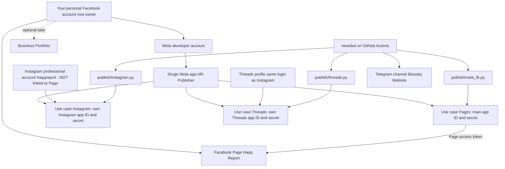
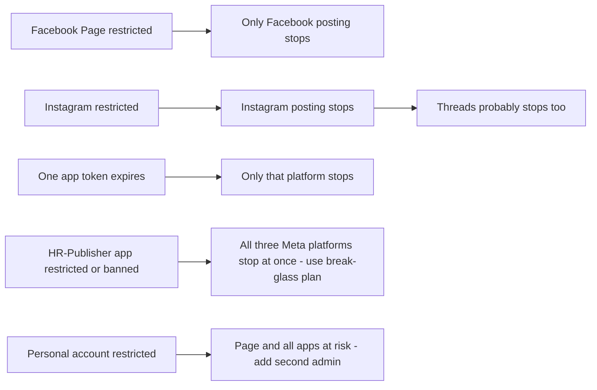
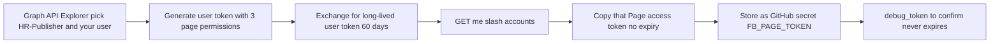
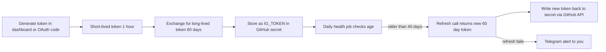
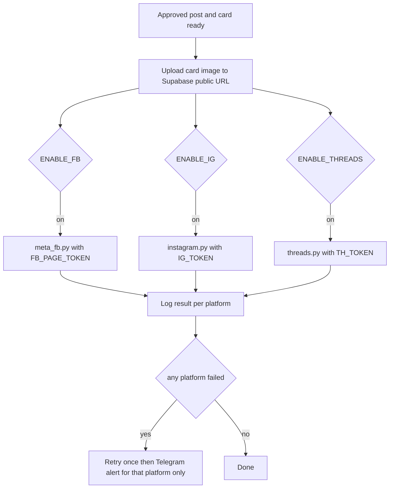
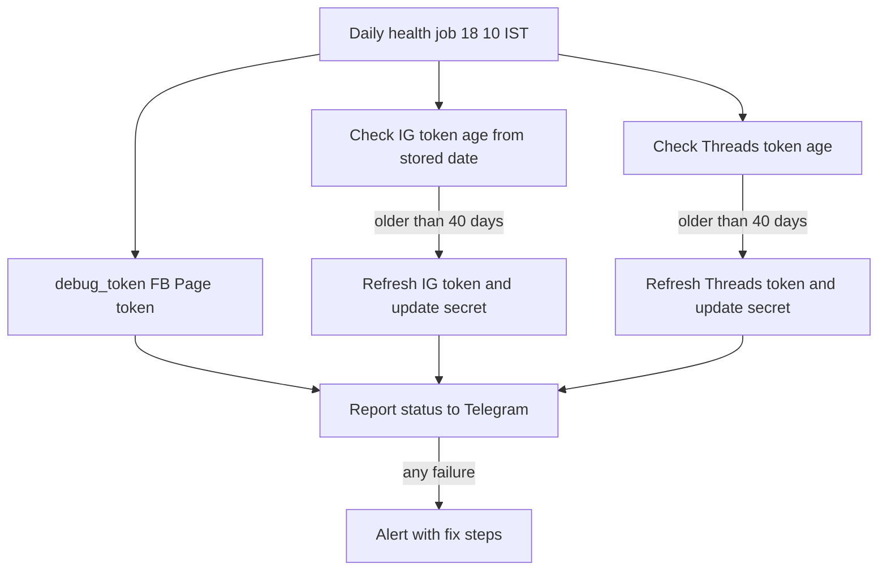
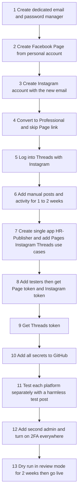

# Haqq Report – Meta Setup & Posting API Configuration

Goal: publish to a Facebook Page, an Instagram account and Threads through **one Meta app**, with a **separate credential set, token and code path per platform** and **no Page-to-Instagram link**, so a token or code problem on one platform does not break the others.

Revised 21 Oct 2026: single app (`HR-Publisher`) instead of three apps.

Written 20 Oct 2026. Meta renames dashboard screens and permissions often, so treat button names as approximate and confirm each step against the current screen and https://developers.facebook.com/docs.

---

## 1. Honest reality check (read before building)

| Your plan | What is true | What to do |
|---|---|---|
| Use personal Facebook account as the owner | This works and is allowed. But the personal account becomes the **root of everything**: Page, developer account, apps. If it is restricted, you lose all three. | Add a second trusted admin to the Page, Business Portfolio and every app (section 9). Keep personal profile real, low-key and clean. |
| Reuse existing Meta developer account | Fine. It is tied to your personal account. | Create **one new app** (not the India In Short app). |
| Do not link Page to Instagram | Possible. The **Instagram API with Instagram Login** needs no Facebook Page. | Use it (section 5). Do **not** use the older "Facebook Login for Instagram" flow, which requires a linked Page. |
| Separate API for Facebook, Instagram and Threads | Yes, inside one app: Instagram and Threads each get their **own app ID and secret** once you add them as use cases. Facebook uses the main app ID and secret plus a Page token. Three tokens, three publisher modules. | Section 3 and 8. |
| Fully independent Instagram and Threads | **Not fully.** A Threads account is created from and tied to an Instagram account. If Meta disables the Instagram account, Threads usually goes with it. | Accept this. Mirror everything to Telegram, Bluesky and the website so no platform is critical. |
| "One app is enough" | For self-use it is fine and simpler. The cost: if Meta restricts the **app itself** (data-use check, policy flag, review problem), all three platforms stop at once. Separate tokens and secrets still protect you from token and permission failures. | Keep the break-glass plan below. Do not try to disguise ownership. Follow the rules, keep an appeals log, and use the second admin. |
| New accounts with no history get blocked | Brand-new accounts and apps often face extra checks. | Use real details, warm up the accounts manually for 1 to 2 weeks before automating. Do not create fake personal accounts. |

---

## 2. Target architecture



Dashed line: add a Business Portfolio only if Meta asks for it; keep Instagram out of it.

### Blast-radius map (what failing takes down)



---

### Single-app trade-off and break-glass plan

What stays separate: credentials (Facebook, Instagram and Threads each have their own ID and secret or token), permissions, tester roles, publisher modules, on/off flags.

What is now shared: the app itself. If it is restricted, everything stops.

Break-glass plan (prepare now, use only if needed):
1. Keep the code so each publisher reads its own credentials only; no platform depends on another.
2. Write down the steps to create a replacement app (`HR-Publisher-2`), re-add the use cases and testers, and swap secrets. About an hour of work if the steps are documented.
3. Keep Telegram, Bluesky and the website running so the audience is never lost while you fix it.
4. Log in to the app dashboard every few weeks and answer any notices (data use, activity).

---

## 3. Accounts and apps to create

| Item | Name / value | Notes |
|---|---|---|
| Dedicated email | e.g. `haqqreport.team@gmail.com` | For Instagram, Threads, Telegram, domain. Not your personal email. |
| Facebook Page | **Haqq Report**, category "News & Media Website" or "Media/News Company" | Created from your personal account. |
| Instagram | `haqqreport`, converted to **Professional (Business or Creator)** in the app | During conversion, **skip** "connect Facebook Page". |
| Threads | Created by logging in with the Instagram account | Same identity as Instagram. |
| Meta App | `HR-Publisher` | One app with three use cases: Pages, Instagram, Threads. |

**App naming:** do not put "Instagram", "Insta", "Facebook" or "Threads" in the app name. Meta rejects trademarked words.

**App type:** choose "Other" / "Business" style app (labels vary). Add the three use cases one by one in the dashboard (Add use case). If the dashboard refuses a combination, tell me the message and we fall back to two apps (Pages in one, Instagram plus Threads in the other).

**Credentials you will end up with (all inside the one app):**

| Platform | ID and secret | Where to find them | Posting credential |
|---|---|---|---|
| Facebook Page | Main App ID and App Secret | App settings, Basic | Page access token (no expiry) |
| Instagram | Instagram app ID and Instagram app secret | Instagram use case, API setup with Instagram login | Instagram user access token (60 days) |
| Threads | Threads app ID and Threads app secret | Threads use case, Settings | Threads user access token (60 days) |

The three ID and secret pairs are different values. Do not paste the main App ID into the Instagram or Threads fields.

**Roles (App roles, Roles):** you are Admin. Add your Instagram account as **Instagram Tester** and your Threads profile as **Threads Tester**. Facebook needs no tester because you are already admin of the app and the Page.

---

## 4. Facebook Page publisher (main app credentials and Page token)

### 4.1 Setup steps

1. Go to developers.facebook.com, My Apps, Create App (skip this if `HR-Publisher` already exists; you only create it once).
2. Name `HR-Publisher`. Add the use case: manage everything on your Page (Pages API). Also add Facebook Login if the dashboard asks for it, so you can generate a user token.
3. App settings, Basic: add contact email, privacy policy URL (use your website page, or a free GitHub Pages page), app icon.
4. Add permissions: `pages_show_list`, `pages_manage_posts`, `pages_read_engagement`. Add `pages_manage_engagement` only if you want the bot to reply to comments.
5. Leave the app in **Development mode**. Because you are the app admin and Page admin, you can post to your own Page without App Review.
6. Copy **App ID** and **App Secret** (Settings, Basic).

### 4.2 Get a never-expiring Page token



Commands (replace values):

```bash
# 1. Long-lived user token
curl -G "https://graph.facebook.com/v21.0/oauth/access_token" \
  -d grant_type=fb_exchange_token \
  -d client_id=$FB_APP_ID \
  -d client_secret=$FB_APP_SECRET \
  -d fb_exchange_token=$SHORT_USER_TOKEN

# 2. Page tokens (derived from a long-lived user token they do not expire)
curl -G "https://graph.facebook.com/v21.0/me/accounts" \
  -d access_token=$LONG_USER_TOKEN

# 3. Check
curl -G "https://graph.facebook.com/v21.0/debug_token" \
  -d input_token=$FB_PAGE_TOKEN \
  -d access_token="$FB_APP_ID|$FB_APP_SECRET"
```
Use the Graph API version currently shown in your dashboard instead of `v21.0` if it is newer.

### 4.3 Posting calls

```bash
# Photo post
curl -X POST "https://graph.facebook.com/v21.0/$FB_PAGE_ID/photos" \
  -d url="https://PUBLIC_IMAGE_URL.jpg" \
  -d message="Caption with attribution" \
  -d access_token=$FB_PAGE_TOKEN

# Multi-photo (carousel-like): upload each unpublished, then one feed post
curl -X POST ".../$FB_PAGE_ID/photos" -d url=... -d published=false -d access_token=$FB_PAGE_TOKEN
curl -X POST ".../$FB_PAGE_ID/feed" -d message="..." \
  -d 'attached_media[0]={"media_fbid":"ID1"}' -d 'attached_media[1]={"media_fbid":"ID2"}' \
  -d access_token=$FB_PAGE_TOKEN

# First comment (put the source link here)
curl -X POST ".../$POST_ID/comments" -d message="Source: https://..." -d access_token=$FB_PAGE_TOKEN

# Retract / delete
curl -X DELETE ".../$POST_ID?access_token=$FB_PAGE_TOKEN"
```

---

## 5. Instagram publisher (own Instagram app ID and secret, no Facebook Page)

This uses **Instagram API with Instagram Login**. It authenticates the Instagram account directly. No Page link, no Facebook token.

### 5.1 Prerequisites
- Instagram account is Professional (Business or Creator). Check in Instagram app, Settings, Account type.
- The account's **display name, bio and profile photo are filled in** and it has a few manual posts.

### 5.2 Setup steps
1. Open `HR-Publisher`, Add use case: manage messaging and content on Instagram (the Instagram API, with Instagram Login).
2. In the dashboard, Instagram section, API setup with Instagram login.
3. Permissions: `instagram_business_basic`, `instagram_business_content_publish`. Add `instagram_business_manage_comments` only if needed.
4. Add your Instagram account as an **Instagram tester**: App roles, Roles, Instagram Testers, add username. Then accept the invite in Instagram app: Settings, Apps and websites, Tester invites.
5. Back in API setup: add the account, then use **Generate token** (or run OAuth below). Copy the token and your **Instagram user ID**.
6. Add redirect URI (any HTTPS page you control, e.g. your website) if you use OAuth.

### 5.3 Token flow (60 days, refreshable)



```bash
# Exchange short for long-lived
curl -G "https://graph.instagram.com/access_token" \
  -d grant_type=ig_exchange_token \
  -d client_secret=$IG_APP_SECRET \
  -d access_token=$SHORT_TOKEN

# Refresh (token must be older than 24 h and not expired)
curl -G "https://graph.instagram.com/refresh_access_token" \
  -d grant_type=ig_refresh_token \
  -d access_token=$IG_TOKEN
```
Note: the Instagram app ID and Instagram app secret shown in the Instagram section are **different** from the main App ID and secret. Use the Instagram ones for every Instagram call.

### 5.4 Publishing (two steps: create container, then publish)

```bash
# Single image
curl -X POST "https://graph.instagram.com/v21.0/$IG_USER_ID/media" \
  -d image_url="https://PUBLIC_IMAGE.jpg" -d caption="..." -d access_token=$IG_TOKEN
# -> returns creation id
curl -X POST ".../$IG_USER_ID/media_publish" -d creation_id=$ID -d access_token=$IG_TOKEN

# Carousel: create each child with is_carousel_item=true, then a parent
curl -X POST ".../$IG_USER_ID/media" -d image_url=... -d is_carousel_item=true -d access_token=$IG_TOKEN
curl -X POST ".../$IG_USER_ID/media" -d media_type=CAROUSEL -d children=ID1,ID2,ID3 -d caption="..." -d access_token=$IG_TOKEN

# Story
curl -X POST ".../$IG_USER_ID/media" -d media_type=STORIES -d image_url=... -d access_token=$IG_TOKEN

# Check status and daily quota
curl -G ".../$CONTAINER_ID" -d fields=status_code -d access_token=$IG_TOKEN
curl -G ".../$IG_USER_ID/content_publishing_limit" -d access_token=$IG_TOKEN
```
Rules to remember: images must be a public JPEG URL (your Supabase public bucket works, as in India In Short); captions have a length cap; there is a daily API publishing limit (check `content_publishing_limit`); links in captions are not clickable.

Deleting an Instagram post through the API is not supported: keep the **manual removal step** in your correction process.

---

## 6. Threads publisher (own Threads app ID and secret)

### 6.1 Setup steps
1. Open `HR-Publisher`, Add use case: access the Threads API. The Threads section shows its own Threads app ID and Threads app secret, different from the main and Instagram ones.
2. Permissions: `threads_basic`, `threads_content_publish` (add `threads_manage_replies` if needed).
3. Add your Threads profile as a **Threads tester**: App roles, Roles, add Threads tester. Accept in Threads app: Settings, Account, Website permissions, Invites.
4. Add redirect URI, run OAuth, then exchange for a long-lived token.

```bash
# Authorize (open in browser, log in with the Instagram/Threads account)
https://threads.net/oauth/authorize?client_id=$TH_APP_ID&redirect_uri=$REDIRECT&scope=threads_basic,threads_content_publish&response_type=code

# Code to short-lived token
curl -X POST "https://graph.threads.net/oauth/access_token" \
  -d client_id=$TH_APP_ID -d client_secret=$TH_APP_SECRET \
  -d grant_type=authorization_code -d redirect_uri=$REDIRECT -d code=$CODE

# Long-lived (60 days)
curl -G "https://graph.threads.net/access_token" \
  -d grant_type=th_exchange_token -d client_secret=$TH_APP_SECRET -d access_token=$SHORT

# Refresh
curl -G "https://graph.threads.net/refresh_access_token" \
  -d grant_type=th_refresh_token -d access_token=$TH_TOKEN
```

### 6.2 Publishing

```bash
curl -X POST "https://graph.threads.net/v1.0/$TH_USER_ID/threads" \
  -d media_type=TEXT -d text="Post text with attribution" -d access_token=$TH_TOKEN
# image: media_type=IMAGE with image_url=...
curl -X POST ".../$TH_USER_ID/threads_publish" -d creation_id=$ID -d access_token=$TH_TOKEN
```
Wait about 30 seconds between create and publish, poll status first. Threads has a text length cap and a daily publish limit, so check current values in the docs.

---

## 7. Dev mode vs Live mode

| Question | Answer |
|---|---|
| Do I need App Review? | **No**, if you only post to assets you own and every account has a role on the app (admin, developer, tester). |
| Do I need Business Verification? | Normally only when you need advanced access to other people's data. Not for self-use. |
| Can I stay in Development mode forever? | Usually yes for self-use. Meta may still send periodic data-use or activity notices. Answer them, and log in to each app dashboard every few weeks. |
| When would I go Live? | Only if you let outside users connect their accounts. Not planned. |

---

## 8. Code layout and secrets (extends the newsbot repo)

```
newsbot/publish/
  meta_fb.py     uses FB_PAGE_ID, FB_PAGE_TOKEN
  instagram.py   uses IG_USER_ID, IG_TOKEN
  threads.py     uses TH_USER_ID, TH_TOKEN
  tokens.py      expiry check and refresh for IG and Threads
  base.py        shared retry, logging, safe-failure rules
```

**GitHub Actions secrets** (never commit, never print in logs):

| Secret | Used by |
|---|---|
| `FB_APP_ID`, `FB_APP_SECRET`, `FB_PAGE_ID`, `FB_PAGE_TOKEN` | Facebook (main app ID and secret) |
| `IG_APP_ID`, `IG_APP_SECRET`, `IG_USER_ID`, `IG_TOKEN` | Instagram (Instagram-specific ID and secret) |
| `TH_APP_ID`, `TH_APP_SECRET`, `TH_USER_ID`, `TH_TOKEN` | Threads (Threads-specific ID and secret) |
| `GH_PAT_SECRETS` | Fine-grained GitHub token used only to update the secrets after a refresh |
| `TELEGRAM_BOT_TOKEN`, `TELEGRAM_OWNER_ID` | Alerts |
| `SUPABASE_URL`, `SUPABASE_KEY` | Storage of images and state |

**Isolation rules in code**
- Each publisher is called inside its own try/except. A failure on one never blocks the others.
- One platform failing three times in a row: auto-pause **that platform only** and alert Telegram.
- Never reuse one token across platforms. Never put Facebook and Instagram tokens in the same function, and never mix the three ID and secret pairs.
- Config flags `ENABLE_FB`, `ENABLE_IG`, `ENABLE_THREADS` in `config.json` so you can switch one off instantly with a Telegram command.

### Publish flow



### Daily token health job (add to existing health workflow)


Keep the token issue date in Supabase (table `tokens`: platform, issued_at, last_refreshed) because the token itself does not tell you its age.

---

## 9. Protecting the root account (the biggest risk in your plan)

1. **Second admin:** invite one trusted person as full admin on the Page, and as admin on the app (App roles, Roles). If your account is locked, they can still recover and keep running.
2. **Two-factor on personal account:** authenticator app, plus saved backup codes stored offline.
3. **Backup recovery:** keep a verified second email and phone on the personal account. Keep ID ready for appeals.
4. **Keep the personal account clean:** do not post Haqq Report content from it, do not run automation on it, do not log in from unusual countries or VPNs.
5. **Page roles:** you are admin. Do **not** give the bot a user login. The bot only holds a Page token.
6. **Business Portfolio:** create one only if Meta requires it for something. If you do, keep Instagram out of it so the Page and Instagram stay unlinked.
7. **Appeals folder:** screenshot every restriction notice, post ID and appeal date.

---

## 10. Setup order (step by step)



### Test checklist
- [ ] Facebook test post appears on the Page, then is deleted via API.
- [ ] Instagram test image appears on the profile; it can be removed manually.
- [ ] Threads test post appears.
- [ ] Turn `ENABLE_FB=false`: Instagram and Threads still post.
- [ ] Break the Instagram token on purpose: Facebook and Threads still post and Telegram gets one alert.
- [ ] Daily health job prints three platform statuses.
- [ ] Second admin can open the app and the Page.

---

## 11. Common errors and fixes

| Error | Meaning | Fix |
|---|---|---|
| OAuth code 190 | Token expired or invalid | Refresh or regenerate, then update the secret |
| Code 10 or 200 "permission" | Permission missing or tester not accepted | Re-add the account as tester, accept invite, regenerate token |
| Code 100 on media | Bad image URL or format | Use a public JPEG URL, check the file is reachable without login |
| Code 4 or 17 "rate limit" | Too many calls | Back off, check `content_publishing_limit` for Instagram |
| "Container not ready" | Published too fast | Poll `status_code` until FINISHED, then publish |
| Instagram account cannot be added | Not a Professional account | Convert in the app first |
| Threads token cannot refresh | Token older than 60 days or app access removed | Run OAuth again |
| Action blocked or temporary restrictions | Account flagged, often for new accounts or sudden automation | Stop automation, post manually for several days, appeal with screenshots |

---

## 12. Rules to keep the setup safe

- No fake personal accounts and no accounts created only to evade a restriction. This can get everything permanently banned.
- Do not automate likes, follows, comments or DMs. Publishing only.
- Respect the Instagram and Threads daily limits, and stay well under them.
- Do not buy followers or engagement.
- Keep a human-visible record of every post and every correction.
- Review Meta's Platform Terms and Community Standards once a quarter. They change.
- Palestine-related content is often over-restricted on Meta. Keep Telegram, Bluesky and the website running so Haqq Report is never dependent on Meta.

---

## 13. Quick summary

| Platform | ID and secret | Login type | Token life | Needs Page link? |
|---|---|---|---|---|
| Facebook Page | Main app ID and secret (HR-Publisher) | Facebook (Page token) | Does not expire | n/a |
| Instagram | Instagram app ID and secret (same app) | Instagram Login, tester role | 60 days, refresh | **No** |
| Threads | Threads app ID and secret (same app) | Threads OAuth, tester role | 60 days, refresh | No (but account is tied to Instagram) |
