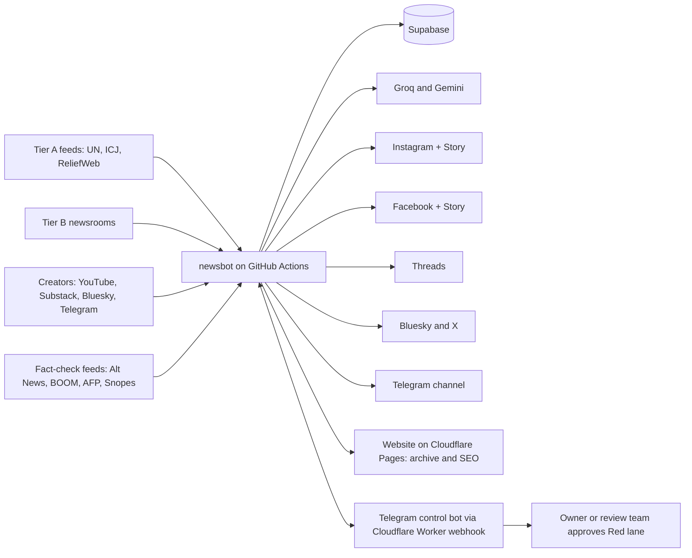
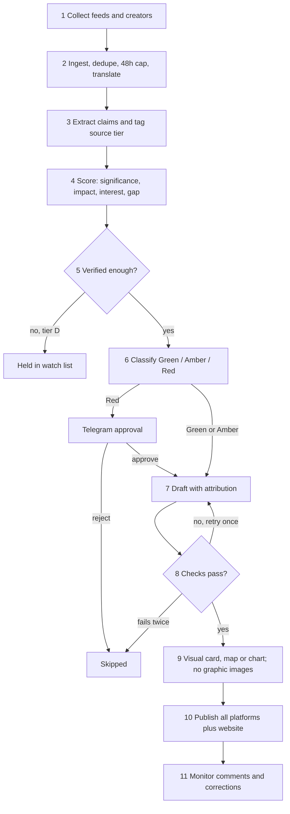
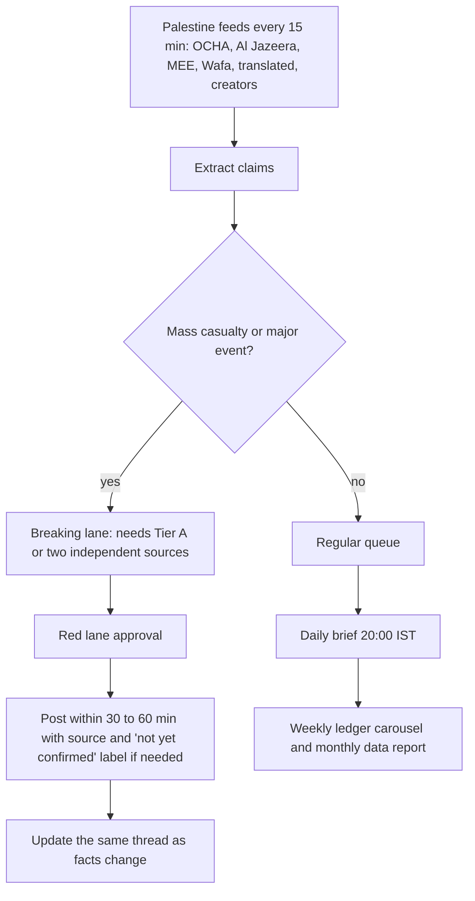
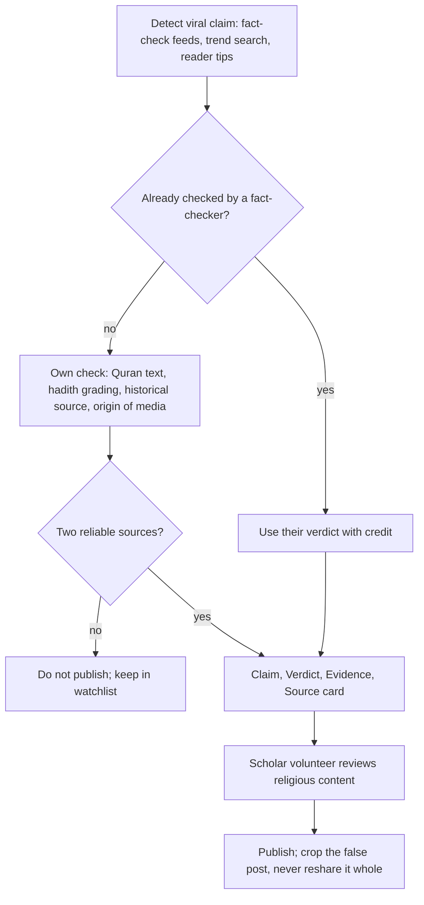

# Haqq Report: Project Plan

> **Status:** planning document, prepared 19 Oct 2026 under the working name "Ummah In Short" (MuslimWorldWatch),
> based on the India In Short documentation. The final name is **Haqq Report**.
> Where this plan and the [README](../README.md) or [Meta setup guide](meta-setup.md) disagree, **those two win**
> (for example, the Meta setup uses the owner's personal account as root and a single Meta app, which supersedes
> the "do not link to your personal profile" line in section 1).

## 0. Five rules that protect the project

1. **Truth beats speed.** One false viral post about Gaza, or about Islam, destroys years of trust. Every claim must be attributed and checked.
2. **Attribute everything.** The old bot never names the source in the text. That works for plain India news. It does NOT work for Gaza, Sudan or Kashmir, where facts are disputed. Write: "the Gaza Health Ministry said", "UN OCHA reported", "journalist X on the ground reported".
3. **Zero hate, zero exceptions.** Criticise governments, armies and policies. Never attack a people or a religion, including Jewish people. This is ethical, and it is also what keeps accounts alive and the owner safe.
4. **Humans approve the risky stuff.** Genocide wording, child victims, graphic video, unverified viral clips, sectarian topics always go to Telegram for approval (Red lane, section 7).
5. **The AI never gives religious rulings.** It may quote verified Quran translations and graded hadith. It never writes fatwas, tafsir or its own interpretation.

This is a working plan, not legal advice. The operator is in India: have a lawyer review section 11 before launch.

## 1. Mission, audience, brand

**Mission:** a free, automated desk that
(a) monitors Palestine and other Muslim-majority crisis zones very closely,
(b) reports Islamophobia and attacks on Muslims anywhere in the world,
(c) amplifies genuine independent journalists and creators that big media skip,
(d) answers fake propaganda about Islam with evidence,
(e) shares Islamic occasions and awareness with respect.

**Audience:** English first (Muslims and non-Muslims who want facts). Later Urdu, Hindi, Arabic, Bahasa.

**Tone:** calm, dignified, factual. Grief is shown through facts and institutions, not shouting. At most 1 or 2 emoji.

**Accounts:** Facebook Page, Instagram professional account, Threads, Telegram channel, Bluesky, website. 2FA everywhere.

## 2. Lessons from India In Short

**Reuse as is:** ingest and dedupe, batch AI scoring, Groq and Gemini failover, number and name checks, retry once then skip, Telegram reports, review mode, Supabase retention, the test suite, run logs in a GitHub issue, plain card for sensitive stories.

**Mistakes and risks found, with fixes:**

| # | Problem in old project | Why it matters here | Fix in new project |
|---|---|---|---|
| 1 | Text never names the outlet or says "according to" | Disputed conflict facts need attribution | Mandatory attribution line and named source in every post |
| 2 | Source link shortened with is.gd or TinyURL | Short links reduce reach and Meta often treats them as spam; Palestine content is already over-moderated | Full publisher URL or own short domain. Link in first comment on Facebook, and on the website post |
| 3 | Instagram links not clickable | Dead end for readers | Every post gets a page on the free website; link in bio goes to the latest-posts hub |
| 4 | Telegram polled every 5 minutes by GitHub Actions, plus hourly ingest | About 300 runs a day; on a private repo this passes the free 2,000 minutes a month | Telegram webhook on a free Cloudflare Worker (instant, zero Actions minutes). If the repo is public, make sure it holds no secrets and the "Run errors" issue leaks nothing |
| 5 | Fixed 4 time slots only | Events in Gaza happen at any hour; GitHub also starts runs 15 to 30 min late | Slots for routine content plus an event-driven Breaking lane |
| 6 | Strict facts check skips many stories | Under-reported stories, the whole point, usually have thin publisher text | Creator verification route (4.3): posted as labelled on-ground reports instead of skipped |
| 7 | Meta tokens expire and error 190 shows up after the fact | Silent downtime | Daily token check that alerts 10 days before expiry |
| 8 | Retract works only for Facebook; Instagram and Threads removed by hand | A false post stays live | Public Corrections log plus `/correct` command; remove where the API allows |
| 9 | One platform family (Meta) | Palestine content is often limited on Meta | Also publish to Telegram channel, Bluesky, website, WhatsApp Channel |
| 10 | Election blackout dates entered by hand | Forgotten date means a legal problem | Calendar file with reminder to Telegram 14 days before |
| 11 | `ELECTION_SILENCE` listed as a secret | It is config, not a secret | Keep it in `config.json` |
| 12 | The two docs disagree slightly | Docs drift | One source of truth: the repo README |
| 13 | No human check except in review mode | Fine for India news, not for genocide claims | Red lane forces approval |
| 14 | Engagement never measured | Cannot improve | Weekly insights report from day one |

## 3. Content pillars

| Pillar | What | Share |
|---|---|---|
| Palestine Watch | Daily brief, breaking updates, humanitarian data, verified testimonies, legal and diplomatic developments, West Bank and Jerusalem | 30% |
| Crisis Watch | Sudan, Yemen, Syria, Lebanon, Afghanistan, Somalia, Rohingya, Kashmir, Xinjiang, Libya and others, using UN and field data | 20% |
| Islamophobia Watch | Hate crimes, discriminatory laws, mosque attacks, bans worldwide, with official or court facts | 15% |
| Voices | Independent journalists and creators, credited and tagged | 10% |
| Myth vs Fact | Claim, verdict, evidence cards | 10% |
| Islam and Occasions | Ramadan, Eid, Hajj, Muharram and more, accurate dates and meaning | 10% |
| Hope | Relief work, achievements, community stories (prevents despair fatigue) | 5% |

Target: 6 to 10 posts a day, at least 2 on Palestine.

## 4. Source strategy

### 4.1 Four source tiers

| Tier | Who | Can it post alone? |
|---|---|---|
| A: Primary | UN agencies (OCHA, WHO, UNICEF, UNRWA, UNHCR, WFP), IPC famine reports, ICJ and ICC documents, court rulings, government statements, Gaza Health Ministry (always named as the source) | Yes, with attribution |
| B: Established newsrooms | Al Jazeera English, Middle East Eye, Reuters, AP, BBC, Guardian, Anadolu, The New Arab, Dawn, Arab News, +972 Magazine, Mondoweiss and similar. Label state-funded outlets honestly | Yes, with attribution |
| C: Independent creators and journalists | Verified on-ground reporters, small outlets, investigative groups, podcasters, YouTube and Substack writers | Yes, only as a labelled "On-ground report: reported by NAME, not independently confirmed yet". Upgrade the label when A or B confirms |
| D: Viral social media | Unknown accounts, reposted clips | Never alone. Needs verification (4.3) |

### 4.2 Finding genuine independent creators (free)

1. Seed list of 40 to 60 names: journalists accredited with press bodies, award winners, reporters listed by CPJ or RSF, and creators repeatedly cited by Tier A and B outlets.
2. Each candidate gets a vetting row in Supabase: years active, past corrections, whether claims were later confirmed, funding or affiliation, language, last 10 posts checked. Score 0 to 10, accept 7 and above.
3. Ingest with free feeds: YouTube channel RSS, Substack and Medium RSS, Bluesky and Mastodon RSS, public Telegram channels through a self-hosted RSS bridge, Google News RSS queries, their own websites.
4. Re-score every creator monthly. Remove anyone who spreads a proven falsehood.
5. Always credit by name and link. Ask permission before using their photo or video. Crediting is also the growth engine (section 17).

### 4.3 Verification route for Tier C and D claims

A claim is upgraded when ANY ONE is true:

- Tier A confirms it.
- Two independent Tier B or C reporters on the ground say the same.
- The video is geolocated and dated by a verification group (Bellingcat, Forensic Architecture, AFP Fact Check, BBC Verify or similar).
- The creator's own score is 9+ and the claim is low-risk.

Automatic rejection: video older than the event (reverse image check on a frame), AI-generated image, photo from another war, screenshot with no original link.

### 4.4 Free data feeds worth adding

ReliefWeb API (OCHA situation reports), UN News RSS, UNRWA situation reports, IPC, UNHCR data portal, WHO emergency pages, ACLED (free for registered users), CPJ journalist database, Humanitarian Data Exchange. Check each licence before reusing content.

### 4.5 Non-English primary sources

Gemini can translate Arabic, Turkish, Urdu, Persian, Indonesian and French. Mark every such item "translated". Normalise Eastern Arabic digits so the number check still works. Post only if key numbers match after translation. This surfaces stories English outlets have not covered yet.

## 5. Architecture

Reuse about 70% of newsbot: same repo layout, same free stack, new modules for tiers, verification, claims, calendar and multi-platform.

## 6. Story pipeline

**New checks added to the old ones:**

- every claim has a named attribution;
- no sentence in the desk's own voice says genocide, ethnic cleansing or war crime; it quotes who said so (ICJ, UN Commission, Amnesty, HRW, B'Tselem and so on);
- no collective-blame wording;
- no praise of designated organisations;
- no casualty figure without its named source.

**Scoring:** keep the old formula (0.35 significance + 0.30 impact + 0.35 interest + bonuses) and add:

- Gap bonus +0.8 when Tier A, B or C reports it and fewer than 2 major wires carried it after 3 hours (the under-reported angle);
- Watch-topic bonus +0.5 for Palestine and priority crises, so they reliably make the cut.

Outrage never raises a score.

## 7. Safety lanes

| Lane | Examples | Rule |
|---|---|---|
| Green | Occasions, Myth vs Fact with a fact-check source, UN data, positive stories | Auto post |
| Amber | Casualty updates, hate-crime reports, court rulings, politics, anything with a named accused | Two sources or Tier A; extra checks; attribution; no photo of people |
| Red | Child victims, graphic content, genocide wording, detainee or hostage stories, unverified viral video, Sunni-Shia or other sectarian topics, designated groups, any call to action, Kashmir and Xinjiang political claims | Never auto-posts. Telegram Approve or Reject with draft, sources and a checklist |

**Dignity rules:** no images of bodies; no identifiable children; victims named only when family or officials released the name; content warning where distressing; add a link to verified relief.

**Wellbeing rule:** reviewers do not watch raw graphic footage; they rely on written verification summaries and fact-check outputs.

## 8. Palestine Watch (closest monitoring)

**Products:**

- **Daily Palestine Brief:** 3 to 5 slides. Verified numbers with attribution (OCHA, ministry named), aid access status, one credited on-ground report, one legal or diplomatic development.
- **Weekly Ledger:** week-on-week aid trucks, hospital status, displacement, journalists killed (CPJ), with a trend chart.
- **Explainers:** timeline, geography, how aid delivery works, what the ICJ cases say, West Bank settlement basics. Evergreen and good for SEO.
- **Rolling live thread** on Telegram and Bluesky for events in progress, corrected in place.
- **Language policy:** quote the legal findings of named bodies rather than characterising events yourself. It is stronger, safer and harder to attack.
- **"What you can do" card:** links to vetted relief organisations only. The desk never collects money itself.

## 9. Answering fake propaganda about Islam

**Rules:**

- Use verified translations (Quran.com API; public-domain Pickthall or Yusuf Ali, or licensed ones where allowed).
- Hadith only with graded sources such as sunnah.com.
- Never debate sects.
- Never fight hate with exaggerated claims. If someone really did something wrong, say so factually. This honesty is what makes people share the debunks.
- Build a **reply kit**: short, polite, sourced replies readers can copy under hateful comments.

## 10. Islamic calendar and festivals

- Dates from the free AlAdhan API (Umm al-Qura). Always add: "may vary by one day with moon sighting"; show Saudi and local (India, Pakistan, Indonesia) when they differ.
- Calendar: Ramadan (daily series), Laylat al-Qadr, Eid al-Fitr, Hajj and Arafah, Eid al-Adha, Islamic New Year, Ashura, Mawlid (observance differs, stay neutral), Isra and Miraj, Shab-e-Barat (regional).
- Post 3 days before, on the day, and a recap. Original cards only. Never draw prophets or religious figures.
- Sectarian neutrality: Sunni, Shia, Ahmadi and others are described by what they say about themselves, never ranked.

## 11. Legal and platform rules

- **India:** posts about communities fall near BNS sections 196 (promoting enmity between groups), 299 (acts meant to outrage religious feelings) and 353 (statements causing public mischief), plus the IT Act. Factual, sourced, non-inflammatory reporting is the protection. **Ask a lawyer to review the policy**, especially Kashmir and India communal content.
- **Other countries:** defamation and speech rules of the UK, EU and US apply to what is shown to those audiences. Never call a named person guilty before a court.
- **Meta policy:** do not praise or support designated groups; describe them factually. Avoid graphic imagery and use content warnings. Screenshot every restriction for appeals.
- **Copyright:** own cards, Wikimedia Commons, OCHA and UN material with attribution, creator material only with permission or a clear licence. Never reproduce whole articles.
- **Corrections log:** mandatory, public, linked in bio.
- **Fundraising:** list only organisations that have been checked (registration, audited accounts, field presence). Re-check quarterly.
- **Operator safety:** brand-only accounts, 2FA, separate email, no home address anywhere, tokens only in GitHub secrets.

## 12. Schedule (IST)

| Workflow | When | Purpose |
|---|---|---|
| Ingest | Hourly; Palestine feeds every 15 min | Collect, translate, score |
| Publish slot | 06:30, 13:00, 20:00, 00:30 | Reaches South Asia, Gulf and Indonesia, Europe, US |
| Palestine brief | 20:30 | Daily brief carousel |
| Breaking lane | Event-driven check every 15 min | Mass-casualty or major diplomatic events |
| Myth vs Fact | 2 a week plus on demand | Fact cards |
| Calendar job | Daily 05:00 | Occasions and reminders |
| Weekly report | Monday 08:45 | Reach, dead feeds, creator scores, corrections |
| Health | Daily 18:10 | Token expiry (alert at 10 days), feed health |
| Keepalive | 1st and 15th | Keep schedules active |
| Telegram webhook | Instant | Commands |

## 13. Platforms and the free stack

| Need | Free choice | Watch out for |
|---|---|---|
| Scheduler | GitHub Actions | Free minutes if repo is private; schedules may run late |
| Database and images | Supabase free tier | 500 MB database, 1 GB storage; pauses if idle |
| AI | Groq and Gemini free tiers | Quota, so keep fallback and batch calls |
| Website | Cloudflare Pages or GitHub Pages (Hugo or Astro) | Free subdomain; custom domain optional |
| Bot webhook | Cloudflare Workers free | 100k requests a day |
| Posting | Instagram, Facebook, Threads (Meta APIs), Bluesky API, Telegram Bot API | X free API is tiny; bonus only |
| Channel | WhatsApp Channel | No API, so post by hand with the link |
| Email (later) | Buttondown or Substack free | Subscriber limits |
| Charts | Python matplotlib in `cards.py` | Keep brand style |

## 14. Data model

Tables: `sources` (tier, language, country, funding, bias_note, last_checked), `creators` (handle, score, corrections_count, permission), `claims` (text, article_id, attribution, status, verified_by), `factchecks` (claim, verdict, evidence_urls), `corrections` (post_id, what_changed, date), `occasions` (name, hijri, gregorian, region_note). The implemented schema is [`db/schema.sql`](../db/schema.sql).

## 15. Telegram commands and settings

Keep: `/status /pause /resume /auto /review /retry /fbtoken /help`. Add: `/approve id`, `/reject id`, `/correct id text`, `/source add url tier`, `/creator score`, `/watch topic`, `/brief now`.

Default mode: **review** for the first 4 weeks, then auto for Green and Amber; Red always manual.

Tunables (in `config.json`): `MAX_POSTS_PER_DAY` 10, `MAX_RED_PER_DAY` 4, `MIN_PALESTINE_PER_DAY` 2, `VERIFY_MIN_TIER`, `BREAKING_CHECK_MINUTES` 15, `GAP_HOURS` 3.

## 16. Roadmap

| Weeks | Milestone |
|---|---|
| 1 | Foundations: accounts, name, policy, lawyer |
| 2 to 3 | Fork repo, source registry, tiers, schema |
| 4 to 5 | Verification, claims, Red lane, translation |
| 6 | Dry run, no posting, review all drafts |
| 7 to 8 | Soft launch, 3 to 4 posts a day, review mode |
| 9 to 12 | Auto for Green and Amber; add Bluesky, site, Myth vs Fact |
| Month 4+ | Languages, creators programme, weekly report |

## 17. How to grow (free)

1. **Creator amplification:** tag and credit every creator used; they often reshare. Run a monthly Creator of the Month.
2. **Shareable formats:** carousels, saveable fact cards, one-sentence summaries. Instagram rewards saves and shares.
3. **Website as archive:** each post gets a sourced page; Google then sends free traffic for searches like "Gaza humanitarian situation today".
4. **Owned audience:** Telegram channel and newsletter, safe from platform bans.
5. **Backup accounts:** reserve a second Instagram and Facebook Page name, and put the Telegram link in every bio.
6. **Series people expect:** Daily Palestine Brief at a fixed time, Myth Monday, Occasion Explainer, Weekly Ledger.
7. **Languages:** Urdu, Hindi, Arabic and Bahasa after month 4, translated by Gemini and checked by a volunteer.
8. **Volunteer review team (3 to 5):** one scholar, one fact-checker, one translator. Lowers the load and raises trust.
9. **Community:** reply in the first hour (manual); add a question sticker in Stories.
10. **Collaborations:** student groups, charities, human rights groups, journalists. Never buy followers or fake engagement.

## 18. KPIs

Posts per day; Palestine posts per day; share of posts with Tier A or B source; corrections per 100 posts (target under 1); time from event to post; saves and shares per post; follower growth; Telegram subscribers; website visits; feed health; creator score changes.

## 19. Risks and mitigations

| Risk | Mitigation |
|---|---|
| Account limited or banned | Multi-platform, backup accounts, appeals log, avoid graphic media |
| Posting a falsehood | Tiers, verification, Red lane, corrections log |
| AI hallucination | Number and name checks, attribution check, every claim must trace to source text |
| Legal action (India or elsewhere) | Lawyer review, factual tone, no guilt labels, no inflammatory wording |
| Source bias | Source registry with funding notes, label state-funded outlets, mix of tiers |
| Burnout and trauma | Written summaries, team rota, no raw graphic review |
| Free-tier limits | Fallback models, caching, Worker webhook, weekly usage check |
| Harassment or doxxing | Brand-only accounts, 2FA, no personal data |
| Looking one-sided | Always attribute; carry official statements from all parties as statements; correct quickly |

## 20. Next steps

1. Confirm the name and create the accounts. **Done: Haqq Report.**
2. Lawyer review of section 11.
3. Fork the newsbot repo and add tiers and sources. **Done in this repository** (starter list in `data/sources.seed.json`).
4. Run a 2-week dry run in review mode.
5. Audit GitHub Actions minutes and the effect of shortened links on India In Short, since fixes 2 and 4 help both projects.
